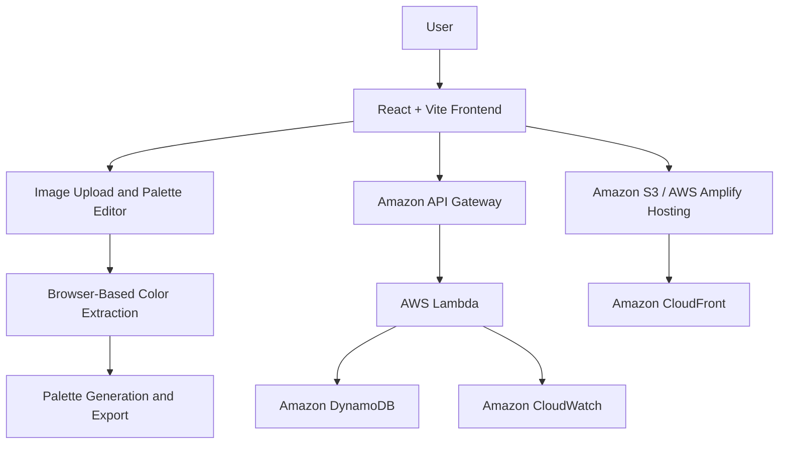

# 🎨 PixelKitchen — Cloud-Based Color Palette Generator

<p align="center">
  <strong>Every image has a palette waiting to be discovered.</strong>
  <br />
  Transform your favorite images into beautiful, customizable color palettes.
</p>

<p align="center">
  
  
  
  
  
</p>

---

## 📖 About the Project

**PixelKitchen** is a cloud-oriented web application that extracts dominant colors from uploaded images and transforms them into customizable color palettes. It provides an interactive workspace for exploring color combinations, previewing designs, and exporting palettes for use in web design, graphic design, and other creative projects.

The project demonstrates cloud architecture concepts through web hosting, serverless computing, cloud storage, and application monitoring using Amazon Web Services (AWS).

## ✨ Features

- 🖼️ **Image Upload:** Upload images in JPG, JPEG, PNG, and WebP formats.
- 🎨 **Automatic Color Extraction:** Extract 5–8 dominant colors from an image.
- 🌈 **Palette Generation:** Create complementary, analogous, triadic, and monochromatic color schemes.
- 🧪 **Color Explorer:** View HEX, RGB, and HSL values for individual colors.
- 🔒 **Color Locking:** Lock preferred colors and regenerate the remaining palette.
- 👁️ **Live Design Preview:** Preview palettes on sample website components.
- 📋 **One-Click Copy:** Copy HEX codes and CSS snippets to the clipboard.
- 💾 **Save Palettes:** Store favorite color combinations for later use.
- 📦 **Export Options:** Export palettes as CSS variables, JSON, or PNG.
- 🪟 **Liquid Glass UI:** Experience a modern interface with translucent panels, smooth transitions, gradients, and animations.
- 📱 **Responsive Design:** Access the application across desktop, tablet, and mobile devices.

*Feature availability depends on the current implementation.*

## 🛠️ Tech Stack

| Technology | Purpose |
|---|---|
| React | Component-based user interface |
| Vite | Development server and build tooling |
| Tailwind CSS | Responsive styling |
| Framer Motion | Animations and transitions |
| JavaScript Canvas / Color extraction library | Image color analysis |
| Amazon S3 / AWS Amplify | Static asset or frontend hosting |
| Amazon CloudFront | Content delivery |
| AWS Lambda | Serverless backend processing |
| Amazon API Gateway | Backend API endpoints |
| Amazon DynamoDB | Persistent palette storage |
| Amazon CloudWatch | Logs and monitoring |

AWS services are part of the planned architecture and should be marked as implemented only after deployment and integration.

## 🏗️ System Architecture



### Architecture Overview

1. **Frontend:** React provides the interactive palette editor and image upload interface.
2. **Color Processing:** Browser-based processing extracts colors without requiring a paid AI API.
3. **Hosting:** AWS Amplify or Amazon S3 with CloudFront delivers the frontend.
4. **Serverless Backend:** API Gateway and Lambda support backend operations when required.
5. **Database:** DynamoDB stores saved palettes and related metadata.
6. **Monitoring:** CloudWatch provides application logs and operational visibility.

The browser-based processing path can work independently of the AWS backend. Backend and database integrations are optional until implemented.

## 🚀 Getting Started

### Prerequisites

Make sure you have installed:

- [Node.js](https://nodejs.org/) — preferably an active LTS version.
- npm, included with Node.js.
- Git.
- A code editor such as Visual Studio Code.

### 1. Clone the repository

```bash
git clone https://github.com/YOUR_USERNAME/YOUR_REPOSITORY.git
```

Replace the URL with your actual GitHub repository URL.

### 2. Navigate to the project directory

```bash
cd YOUR_REPOSITORY
```

### 3. Install dependencies

```bash
npm install
```

### 4. Start the development server

```bash
npm run dev
```

Open the local URL displayed in your terminal, usually:

```text
http://localhost:5173
```

### 5. Build for production

```bash
npm run build
```

Vite generates the production build in the `dist/` directory.

To preview the production build locally:

```bash
npm run preview
```

## ☁️ AWS Deployment

PixelKitchen can be deployed using AWS Amplify Hosting or Amazon S3 with CloudFront.

### Option A: AWS Amplify Hosting

1. Open the [AWS Amplify Console](https://console.aws.amazon.com/amplify/apps).
2. Connect your GitHub account.
3. Select the PixelKitchen repository and deployment branch.
4. Configure the build command as `npm run build`.
5. Set the output directory to `dist`.
6. Deploy the application.
7. Verify the deployed URL and test the main features.

Amplify can automatically redeploy the website when changes are pushed to the connected branch.

### Option B: Amazon S3 and CloudFront

1. Run `npm run build`.
2. Create an S3 bucket configured for secure static website delivery.
3. Upload the contents of `dist/`.
4. Configure CloudFront with the S3 bucket as its origin.
5. Configure appropriate access permissions and HTTPS delivery.
6. Test the deployed application.

For production use, prefer CloudFront with a private S3 origin rather than making the bucket publicly accessible.

## 💰 Cost Considerations

The project is designed to minimize infrastructure costs.

- Perform basic image processing in the browser.
- Avoid paid AI APIs and unnecessary backend calls.
- Use AWS services only when required.
- Monitor service usage and configure billing alerts.
- Remove unused resources after testing.

AWS usage is not guaranteed to be free. Charges depend on account eligibility, service usage, and applicable Free Tier allowances.

## 🎯 Project Objectives

- Develop an interactive web application for extracting and customizing color palettes from images.
- Demonstrate cloud architecture concepts through deployment, serverless computing, storage, and monitoring.
- Provide a practical, user-friendly design utility with palette editing and export capabilities.

## 🔮 Future Enhancements

- User authentication and personalized palette collections.
- Integration with AWS Cognito for identity management.
- Cloud-based image processing through Lambda.
- Palette sharing through unique URLs.
- Accessibility-focused color contrast recommendations.
- Advanced gradient generation and design templates.
- Analytics for palette usage and user interactions.

## 🎓 Academic Information

| Field | Details |
|---|---|
| Project | PixelKitchen |
| Course | Cloud Architecture Design |
| Course Code | BCSE355L |
| Institution | Vellore Institute of Technology, Chennai Campus |
| Project Type | Individual Mini-Project |
| Deployment Platform | Amazon Web Services (AWS) |

## 👨‍💻 Author

**Rajat Mishra**

B.Tech — Computer Science and Engineering, AI & Robotics Specialization  
Vellore Institute of Technology, Chennai Campus

---

<p align="center">
  <strong>Made with creativity, code, and a little bit of color. 🎨</strong>
</p>
